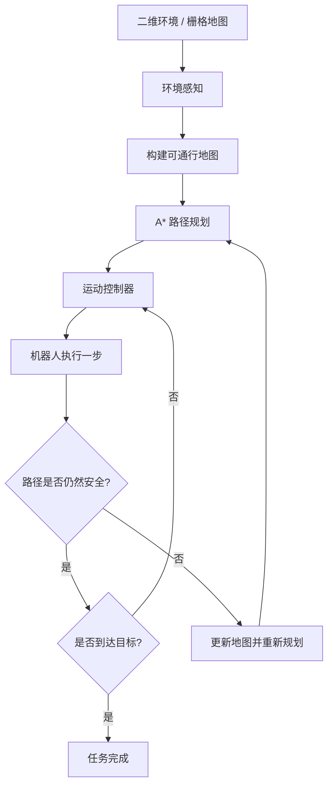
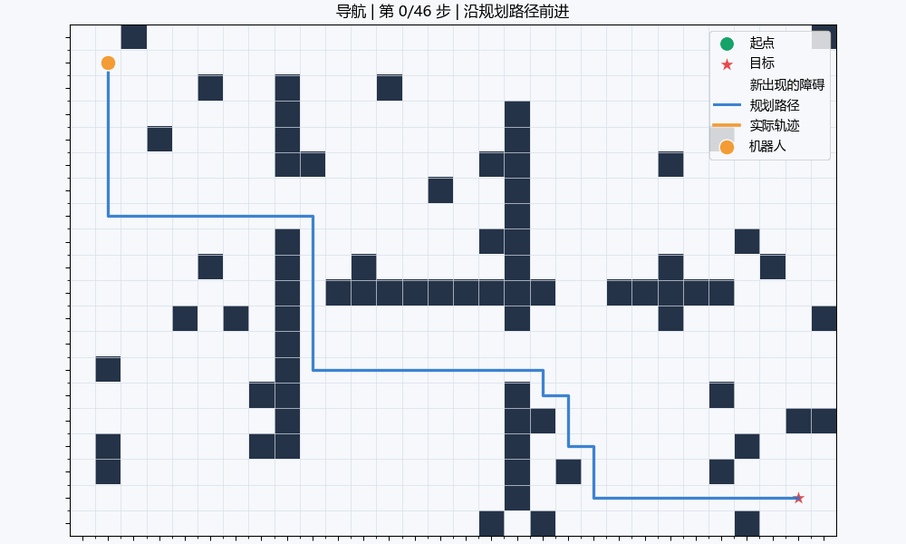

<div align="center">

# 🤖 Embodied AI · Robot Obstacle Avoidance

**从二维栅格世界出发，理解机器人如何感知环境、规划路径、执行运动并根据反馈重新规划。**


[项目介绍](#-项目简介) · [快速开始](#-快速开始) · [运行效果](#-运行效果) · [学习教程](#-学习路线) · [项目结构](#-项目结构)

</div>

---

## 🌟 项目简介

这是一个面向具身智能初学者的**机器人自主避障入门项目**。我们在一个二维栅格环境中创建机器人、障碍物和目标点，让机器人使用 A* 算法寻找可行路径，并通过运动控制器逐步执行路径。

项目刻意从简单、可解释的算法开始，不依赖真实机器人，也不要求安装大型物理仿真平台。你可以先看懂每个模块，再逐步替换成激光雷达、SLAM、ROS 2 或强化学习组件。

> **学习定位：** 这是一个具身智能/移动机器人导航的教学型简化模型，不是完整的物理仿真器。当前环境采用离散栅格，机器人运动采用简化运动学。

### 项目能做什么？

- 🗺️ 创建二维栅格地图，设置起点、终点和障碍物
- 🧭 使用 A* 算法规划从起点到目标的路径
- 🚗 使用简化运动控制器跟踪路径
- 🔄 模拟执行途中出现新障碍物，并触发重新规划
- 📊 统计路径长度、搜索节点数和重规划次数
- 🎞️ 输出静态地图图片和动态演示 GIF

### 核心流程



## 🖼️ 运行效果

运行主程序后，会在 `outputs/` 中生成地图图像与动画：

- `navigation_demo.png`：最终路径、障碍物、起点和目标点
- `navigation_demo.gif`：机器人移动过程
- 终端输出：路径长度、搜索节点数、重规划次数等指标



> 如果 GIF 尚未生成，先按照下方“快速开始”运行 `python -m embodied_nav.main`。

## 🚀 快速开始

### 1. 环境要求

- Python 3.10 或更高版本
- Windows、macOS 或 Linux
- 无需 NVIDIA GPU
- 无需真实机器人或 MuJoCo / Isaac Sim

### 2. 下载项目并进入目录

```bash
cd Embodied-AI-Obstacle-Avoidance
```

### 3. 创建虚拟环境（推荐）

Windows PowerShell：

```powershell
py -3.10 -m venv .venv
.venv\Scripts\Activate.ps1
```

macOS / Linux：

```bash
python3 -m venv .venv
source .venv/bin/activate
```

### 4. 安装依赖

```bash
python -m pip install --upgrade pip
pip install -r requirements.txt
pip install -e .
```

`pip install -e .` 会把 `src/` 下的项目包安装到当前虚拟环境中；以后修改源码无需重复安装。

### 5. 运行演示

```bash
python -m embodied_nav.main
```

程序会在项目根目录创建 `outputs/`，并生成 PNG 与 GIF。运行结束后，终端会打印实验指标。

### 6. 运行测试

在项目根目录执行：

```bash
python -m unittest discover -s tests -v
```

## 🎮 可视化交互

项目提供两个入口：

| 命令 | 功能 |
|---|---|
| `python -m embodied_nav.main` | 运行默认场景，生成 PNG、GIF 和指标 |
| `python -m embodied_nav.main --view 3d` | 同一套规划结果的三维场景，生成 PNG 和 GIF |
| `python -m embodied_nav.main --view both` | 同时生成俯视图和三维场景 |
| `python -m embodied_nav.main --view 3d --interactive` | 打开可拖拽旋转的三维窗口 |
| `python -m embodied_nav.main --no-animation` | 只生成静态图，速度更快 |
| `python -m embodied_nav.main --seed 7` | 使用指定随机种子复现实验 |

地图颜色说明：

| 颜色/标记 | 含义 |
|---|---|
| 深色格子 | 障碍物 |
| 浅色格子 | 可通行区域 |
| 蓝色线条 | A* 规划路径 |
| 绿色圆点 | 机器人起点 |
| 红色星标 | 目标位置 |
| 橙色圆点 | 机器人当前位置 |

三维场景把同一张占据栅格立起来：可通行区是地面，障碍物是墙，橙色柱是途中新出现的障碍。规划算法、运动方式和指标都与俯视图相同。GIF 里相机会缓慢转动；加上 `--interactive` 后可以用鼠标自行旋转。这是栅格世界的立体展示，不是物理引擎仿真。

## 🧠 学习路线

建议按顺序阅读 `docs/`：

1. [01 · 项目导览](docs/01_项目导览.md)：理解任务、模块和运行流程
2. [02 · 栅格地图与环境建模](docs/02_栅格地图与环境建模.md)：理解坐标、障碍物和环境表示
3. [03 · A* 路径规划算法](docs/03_A星路径规划.md)：理解启发式搜索、代价函数和路径恢复
4. [04 · 机器人运动控制](docs/04_机器人运动控制.md)：理解路径跟踪与离散运动
5. [05 · 动态障碍与重新规划](docs/05_动态障碍与重新规划.md)：理解闭环反馈
6. [06 · 实验与指标分析](docs/06_实验与指标分析.md)：运行实验并分析结果

## 🧱 项目结构

```text
Embodied-AI-Obstacle-Avoidance/
├── README.md
├── requirements.txt
├── LICENSE
├── .gitignore
├── src/
│   └── embodied_nav/
│       ├── __init__.py
│       ├── environment.py      # 地图、障碍物与碰撞检测
│       ├── planner.py          # A* 搜索与路径恢复
│       ├── controller.py       # 路径跟踪与移动
│       ├── simulation.py       # 闭环仿真、动态障碍与重规划
│       ├── visualization.py    # 俯视图与 GIF
│       ├── visualization_3d.py # 三维场景、GIF 与交互窗口
│       └── main.py             # 命令行入口
├── docs/                       # 中文分步教程
├── examples/
│   └── custom_scene.py         # 自定义地图示例
├── assets/
│   └── demo.gif                # 项目演示动画
└── tests/
    └── test_navigation.py      # 单元测试
```

## 🧩 核心算法

A* 使用以下评价函数选择待扩展节点：

\[
f(n) = g(n) + h(n)
\]

其中：

- \(g(n)\)：从起点到当前节点的实际累计代价
- \(h(n)\)：当前节点到目标节点的启发式估计
- \(f(n)\)：经过当前节点到达目标的总代价估计

本项目使用四邻接移动（上、下、左、右），因此采用曼哈顿距离：

\[
h(n) = |x_n-x_g| + |y_n-y_g|
\]

每次移动代价为 1。动态障碍物出现后，机器人先检查剩余路径是否仍可通行；若路径被阻断，则更新地图并重新调用 A*。

## 🔬 可以继续扩展什么？

完成基础项目后，可以按下面的方向升级：

| 版本 | 扩展方向 | 新增能力 |
|---|---|---|
| V1.1 | Dijkstra / BFS 对比 | 比较不同搜索算法 |
| V1.2 | 八方向移动 | 对角线运动与欧氏距离 |
| V1.3 | 激光雷达模拟 | 从传感器读数构建局部地图 |
| V1.4 | 动态窗口法 DWA | 速度空间中的局部避障 |
| V2.0 | ROS 2 + Gazebo | 连接机器人中间件与仿真器 |
| V3.0 | 强化学习导航 | 学习策略而不只依赖手工规划 |

## 🧪 技术栈

- Python：项目主体
- NumPy：地图数组与数值计算
- Matplotlib：地图绘制与动画
- A*：全局路径规划
- unittest：基础测试

## 📌 已知简化与限制

为了便于入门，本项目做了以下简化：

1. 地图是已知的二维栅格地图，不包含真实传感器噪声。
2. 机器人被建模为一个点，不考虑车体尺寸、惯性和动力学约束。
3. 机器人每次沿四邻接方向移动一个格子。
4. 动态障碍物在预设时刻出现，用于演示重新规划机制。
5. A* 是经典图搜索算法，不是机器学习模型。

这些简化让我们能够专注理解“环境—感知—规划—行动—反馈”的基本闭环。后续再逐步加入更真实的机器人模型。

## 📄 许可证

本项目采用 [MIT License](LICENSE)，欢迎学习、修改和扩展。
